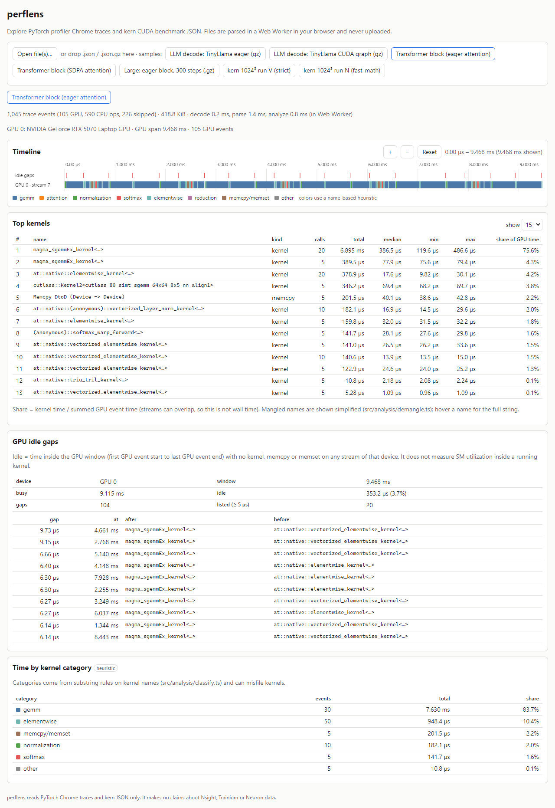
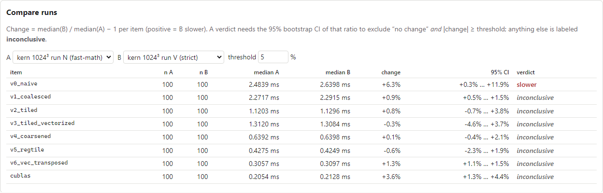
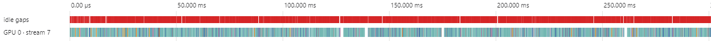
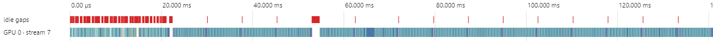

# perflens

A browser tool for reading GPU performance evidence: **PyTorch profiler
Chrome traces** and **[kern](https://github.com/mauliksamit/kern) CUDA
benchmark JSON**. Load a file (or a bundled sample) and get a zoomable
kernel timeline, a top-kernel table, GPU idle-gap analysis, and a run
comparison that labels differences inside the noise band **inconclusive**.
Files are parsed in a Web Worker in your browser and never uploaded.

**Live demo:** _placeholder — link goes here once GitHub Pages is enabled for this repo._





TinyLlama-1.1B decode (from [llm-bringup](https://github.com/mauliksamit/llm-bringup)),
batch 1: eager decode (top) leaves the GPU idle between launches — the red
idle-gap lane — while CUDA-graph decode (bottom) closes most of those gaps.




## What it does

| Feature | How | Where |
|---|---|---|
| Reads PyTorch profiler Chrome traces | complete (`ph: "X"`) GPU events by Kineto category (kernel / memcpy / memset), launch metadata kept; `.json` or `.json.gz` | `src/parse/chromeTrace.ts` |
| Reads kern benchmark JSON | per-kernel median/min/p95 and raw per-iteration timings | `src/parse/kernBench.ts` |
| Zoomable kernel timeline | canvas, one lane per (device, stream) plus an idle-gap lane; wheel zoom, drag pan, buttons | `src/ui/Timeline.tsx` |
| Top-kernel table | group by name, rank by total time | `src/analysis/topKernels.ts` |
| GPU idle-gap analysis | union of GPU activity across streams; gaps listed with the kernels around them | `src/analysis/idleGaps.ts` |
| Run comparison with a noise band | ratio of medians + seeded 95% bootstrap CI + a practical threshold; otherwise "inconclusive" | `src/analysis/compare.ts` |
| Large traces off the main thread | parsing and analysis run in a module Web Worker | `src/worker/` |
| Time by kernel category | **heuristic** substring rules on kernel names, labeled as such in the UI | `src/analysis/classify.ts` |

Definitions, data flow and design choices: [`docs/ARCHITECTURE.md`](docs/ARCHITECTURE.md).
What it does not do: [`docs/LIMITATIONS.md`](docs/LIMITATIONS.md).

## Measured facts

Every number below is generated from `results/facts.json` (see
[`docs/RESUME_FACTS.md`](docs/RESUME_FACTS.md)); `npm run audit` fails if
README or docs contain a number that cannot be traced to a generated file.

<!-- FACTS-BEGIN -->
| Fact | Value | Source |
|---|---|---|
| Largest sample | `data/traces/llm/tinyllama_s2_sdpa_b1_p128.json.gz`: 107,107 trace events (13,905 GPU events), 34565.7 KiB of JSON (1835.0 KiB gzipped) | results/facts.json → largest_sample_parse |
| Parse + analyze in the browser Web Worker | 112.2 ms median of 5 page loads (chromium 131.0.6778.33 (Playwright, headless)) | results/browser_parse.json (via facts.json → browser_parse) |
| Parse + analyze in Node | 225.6 ms median of 7 (JSON.parse alone 91 ms) | results/facts.json → largest_sample_parse |
| Unit tests (Vitest) | 31 passed of 31 in 2 files | results/facts.json → unit_tests |
| End-to-end tests (Playwright) | 6 tests in 1 file (pass/fail: CI run, see LOG.md) | results/facts.json → e2e_tests |
| Production JS bundle | 166.4 KiB (54.9 KiB gzipped), incl. the worker chunk | results/facts.json → bundle |
| Lighthouse / load metrics | NOT RUN: no Lighthouse run in this environment | results/facts.json → lighthouse |

<sub>Machine: AMD Ryzen AI 7 350 w/ Radeon 860M, win32 10.0.26200, Node v24.21.0; facts generated at commit `3116c6f` on 2026-10-15T07:33:55Z. Generated by `scripts/render_facts.mjs`.</sub>
<!-- FACTS-END -->

## Samples (all real)

| File | What | Provenance |
|---|---|---|
| `data/traces/llm/tinyllama_s2_sdpa_b1_p128.json.gz` | TinyLlama-1.1B, bf16, eager decode, batch 1, 16 tokens | copied from llm-bringup; `.meta.json` names the source commit and environment |
| `data/traces/llm/tinyllama_s4_cuda_graph_b1_p128.json.gz` | same workload with CUDA-graph decode | same |
| `data/traces/block_eager.json` | one transformer block, explicit attention, 5 profiled steps | `.meta.json`: RTX 5070 Laptop, driver 617.14, torch 2.14.1+cu130, FP32, TF32 off, command |
| `data/traces/block_sdpa.json` | same block with `scaled_dot_product_attention` | same |
| `data/traces/block_eager_300steps.json.gz` | eager block, 300 steps (large sample) | same |
| `data/kern/bench_M1024_runV_strict.json` | kern SGEMM ladder at 1024³, strict IEEE build | copied from kern commit `883145c` |
| `data/kern/bench_M1024_runN_fastmath.json` | same, `--use_fast_math` build | copied from kern commit `e627dc2` |

Traces come from `scripts/make_traces.py` (torch.profiler; FP32 with TF32
disabled and asserted; local paths and host name stripped).

## Run it

```bash
npm ci
npm run dev          # http://localhost:5173
npm test             # Vitest unit tests
npm run build        # production build in dist/
npx playwright install chromium
npm run e2e          # Playwright tests against the production build
npm run lint && npm run typecheck && npm run audit
```

Regenerate evidence (needs a CUDA build of PyTorch for the traces):

```bash
python scripts/make_traces.py --variant eager --steps 5 --out data/traces/block_eager.json
python scripts/make_traces.py --variant sdpa  --steps 5 --out data/traces/block_sdpa.json
python scripts/make_traces.py --variant eager --steps 300 --out data/traces/block_eager_300steps.json --gzip
npm run build && npm run screenshots   # docs/screenshots/*.png + results/browser_parse.json
npm run facts                          # results/facts.json
node scripts/render_facts.mjs          # README facts block + docs/RESUME_FACTS.md
```

CI (`.github/workflows/ci.yml`) runs lint, typecheck, unit tests, build,
claims audit and the Playwright tests on every push. `pages.yml` deploys
`dist/` to GitHub Pages once Pages is enabled for the repository.

## Scope

perflens reads PyTorch Chrome traces and kern JSON. It does not read Nsight
Systems/Compute reports and makes no claims about Trainium or Neuron
profiles. "Idle" means no GPU activity recorded by the profiler, not SM
utilization. See [`docs/LIMITATIONS.md`](docs/LIMITATIONS.md).

## How this was built

Written with an AI coding agent working under this repo's `AGENTS.md`
(no invented numbers, every figure generated from `results/`, one change
per commit), with the author directing the work, running the GPU trace
generation on their own RTX 5070 Laptop, and verifying the results.
[Author: please confirm this description.]

## References

[`docs/REFERENCES.md`](docs/REFERENCES.md). Engineering log: [`LOG.md`](LOG.md).
Negative results and cut features: [`docs/NEGATIVE_RESULTS.md`](docs/NEGATIVE_RESULTS.md).
License: MIT.
